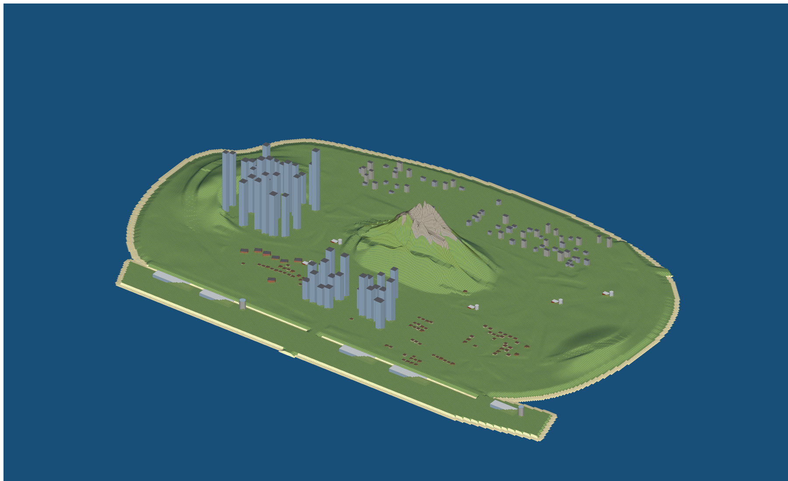

# island-buildings — every building on the island



`tools/gen-island-buildings.js` builds every building `island-map.html` draws, as 3D models standing on
the terrain. There are **230 buildings in 41 tiles**:

| type | count | height |
|---|---|---|
| West towers | 26 | the floors in their map title × 3.5 m (45–95 floors, up to 327 m) |
| 1017 towers (south + north) | 22 | the floors in their map title × 3.5 m (25–64 floors) |
| 312 offices | 63 | 3–12 floors × 4 m |
| 1017 houses / frontage | 93 | 1–2 floors, pitched roof |
| 1017 apartment rows | 7 | 3–5 floors |
| Airport terminals | 5 | 15 m |
| Control towers | 2 | 48 m, round |
| Farm barns + silos | 6 + 6 | 7 m barns with a pitched roof, 22 m silos |

- **Footprints:** each one is the map's own footprint, turned the same way, scaled 2 m per map unit.
- **Placement:** each building sits on `island-terrain/ground.f32`. Its walls start 1 m below the lowest corner, so nothing floats on a slope.
- **Heights don't change between runs:** a building's random height comes from its position.

```
python3 tools/gen-island-terrain.py      # ground (and roads) first
node tools/gen-island-buildings.js       # then the buildings
```

| file | what |
|---|---|
| `obj/island_bldg_<col>_<row>.obj` + `island_buildings.mtl` | One mesh per terrain tile. x/y are local to the tile's centre, z is the real height. |
| `xml/island_buildings.ytyp.xml` / `.ymap.xml` | Archetypes and placements (texture dictionary `island_buildings`). |
| `buildings.json` | Every building: type, floors, base/top height, footprint. |
| `preview.png` / `preview-top.png` | Isometric view on the terrain / top-down, coloured by height. |

**Materials** (with collision type):

| material | collision |
|---|---|
| `bldg_glass_tower`, `bldg_concrete`, `bldg_office`, `bldg_roof_flat` | CONCRETE |
| `bldg_brick` | BRICK |
| `bldg_siding`, `bldg_barn` | WOOD_SOLID_MEDIUM |
| `bldg_roof_shingle` | ROOF_TILE |
| `bldg_metal` | METAL_SOLID_MEDIUM |

Wall UVs repeat once every 4 m across and once per floor up, so a one-floor window texture lines up
with the floors.

## Turning it into game files

These are the same steps as `island-terrain/`:

1. In Blender, use Sollumz to import each OBJ and convert it to a Drawable. Give each material a shader and texture, and put the textures in `island_buildings.ytd`.
2. Export each tile as `island_bldg_<c>_<r>.ydr`, plus a Bound Composite `.ybn` with the collision types above.
3. In CodeWalker, use **Import XML** on the ytyp and the ymap.
4. Put everything in `island-buildings/stream/`.
5. `ensure island-buildings` after `ensure island-terrain`.

## Known limits

- **Blocks:** buildings are plain blocks with flat or pitched roofs. Detail comes from the textures you choose.
- **No interiors:** none of the buildings can be entered.
- **No distant models:** tiles draw in full out to 1,500 m, the same as the terrain. The 300 m towers would benefit from simple distant versions later.
- **Density:** the 312 is as sparse as the 2D map. Its generator dropped any building that landed on a road. To add more, add them to `tools/gen-island-map.py`, regenerate the map, and rerun this script.
