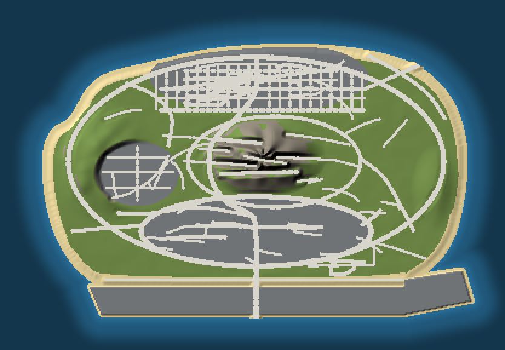

# island-terrain — the island's ground



`tools/gen-island-terrain.py` builds the ground the roads sit on, as **99 tiles of 256 m**
(33 × 33 height samples, 8 m apart):

- **Land:** at road level (Z 10), with gentle farm swells.
- **Coast:** a 45 m beach down to the waterline, then a seabed falling to −20 m.
- **The mountain:** about 300 m above road level. The west hills rise 70 m and the east ridge 32 m.
- **Flat pads:** the 312 grid, the 1017 towers, the west tower district and the airport. The airport is a raised pad with a sea wall.
- **Under every road:** the ground is flat at the road's height and blends back to the land within 28 m. Where a road climbs a hill, the ground is cut or filled to match it.

It also reruns `tools/gen-road-ymaps.js`, so the roads climb the same hills. Their grade is capped
at 12% and each piece is tilted to its slope. Where the hill is steeper than that, the ground is cut
down to the road.

```
python3 tools/gen-island-terrain.py      # rebuilds island-terrain/ AND island-roads/xml/ (numpy only)
```

| file | what |
|---|---|
| `obj/island_terrain_<col>_<row>.obj` + `island_terrain.mtl` | One mesh per tile. x/y are local to the tile's centre, z is the real height. Four materials: `island_grass`, `island_sand`, `island_rock`, `island_pavement`. |
| `xml/island_terrain.ytyp.xml` | One archetype per tile (name = the OBJ's name, texture dictionary `island_terrain`). |
| `xml/island_terrain.ymap.xml` | Places every tile at its centre. |
| `heightmap.png` | 16-bit, north up, 1 step = 1 cm above `heightmapMinZ` in `terrain-index.json`. |
| `terrain-index.json` | Each tile's centre, height range and materials. |
| `road-guide.*` | The hill heights handed to the road generator. |

## Turning it into game files

GTA needs each tile as a model (`.ydr`) plus collision (`.ybn`). The usual tool is
**Blender + Sollumz**:

1. Import each `obj/*.obj` (Z up, Y forward; keep the tile at the origin).
2. Convert the mesh to a **Drawable** and give each material a terrain shader. `terrain_cb_w_4lyr` or plain `default` both work, with grass, sand, rock and concrete textures.
3. Export `island_terrain_<c>_<r>.ydr`. Put the textures in one `island_terrain.ytd`.
4. Duplicate the mesh, convert it to a **Bound Composite** (collision), and set each material's collision type:
   - `island_grass` → GRASS
   - `island_sand` → SAND_COMPACT
   - `island_rock` → ROCK
   - `island_pavement` → CONCRETE

   Export `island_terrain_<c>_<r>.ybn`.
5. In CodeWalker, **Import XML** on `xml/island_terrain.ytyp.xml` and `xml/island_terrain.ymap.xml`.
6. Put every `.ydr`, `.ybn`, the `.ytd`, the `.ytyp` and the `.ymap` in `island-terrain/stream/`.

Then in `server.cfg`:

```
ensure island-terrain
ensure island-roads
```

## Known limits

- **Junctions on hills:** where two roads meet on a hill they can sit at different heights. On flat land they all sit at Z 10.
- **The west tower district** is a flat pad set into the west hills, so it reads as a bowl.
- **Roads past the coast** (the docks causeways, the bridge south of the airport) stay at Z 10 over the sea, with no ground under them.
- **No LOD models:** each tile draws out to 1,500 m.
- **No ocean check:** whether GTA's ocean covers this spot (X −5500, Y −6500) hasn't been checked. Move `centre` in `tools/gen-road-ymaps.js` if needed and rerun.
