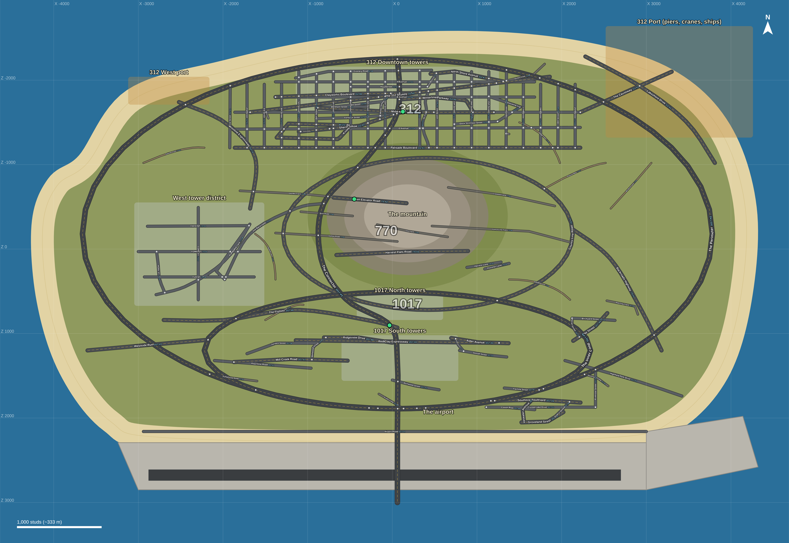

# Fourtune Town — Roblox core server

An original town-roleplay game for Roblox, built on the same rules as the
GTA server in this repo. "Fourtune Town" is a placeholder name: change it
in `src/shared/Config.luau`.

This is **phase 1, the core server**: saving, money and inventory. No map,
jobs, houses or cars yet.

## What's in it

| Piece | File | What it does |
|---|---|---|
| Saving | `src/server/Services/DataService.luau` | DataStore load/save with a **session lock** (no duplicating money by server-hopping), retries, autosave every 2 min, save on leave, save everyone on shutdown |
| Money | `src/shared/Economy.luau` | Cash, bank, gold. Port of `js-snippets/economy.js` |
| Inventory | `src/shared/Inventory.luau`, `src/shared/Items.luau` | 13 items, 30 kg limit. Port of `js-snippets/inventory.js` |
| Requests | `src/server/Services/Network.luau` | The only way in from clients: known actions only, rate limited, errors caught |
| Actions | `src/server/Services/PlayerActions.luau` | deposit, withdraw, pay, use item, drop item |
| Admin | `src/server/Services/Admin.luau` | Grants from the server side only |
| Display | `src/client/Client.client.luau` | Money bar, bank box (B), inventory (I) |
| Tests | `src/server/Tests.luau` | Logic checks that print in Studio on every Play |
| Settings | `src/shared/Config.luau` | Every number worth tuning |

The rule carries over from the GTA server: **the server decides, clients
only ask.** A modded client sending `-5000`, `NaN`, a string or an item that
doesn't exist gets refused, and nothing changes.

Same as the GTA server:
- Start with $500 cash and $5,000 bank.
- The starter kit is 2 water, 1 sandwich and 1 phone. Only players who have
  never saved get it; an inventory you emptied stays empty.
- Using an item consumes exactly 1, and only after every check passes. A
  bandage used at full health is refused and kept.
- Exactly 30.0 kg is allowed; anything over is refused.

Not carried over:
- **Weapons and ammo.** There's no weapon system yet.
- **The drug items.** Roblox's Community Standards don't allow illegal
  drug content.
- **Hunger and thirst.** Food is consumed but doesn't do anything yet,
  until `needs.js` is ported.

## The map



The whole island from the GTA project, at Roblox scale. It's about
**8,300 x 4,700 studs** (2.8 x 1.6 km), and every one of the island's **108
roads** carries its real name.

| Built by `src/server/Map/MapBuilder.luau` | Count |
|---|---|
| Named roads (asphalt, with centre lines on highways and arterials) | 108 |
| Junctions | 276 |
| Street signs: a green blade per road at every junction, plus one every ~900 studs on long stretches | 345 |
| Floating road names (`MAP_FLOATING_ROAD_NAMES`) and city and district names | 108 + 11 |
| Spawns: 312 at C Ave & Midway Ave; 770 at Grain Elevator Rd; 1017 at The Connector & The Flyover | 3 |
| Terrain: sea, beach, grass, a 700-stud mountain with a snow cap, the airport apron and runway | |

That comes to about 2,600 parts plus terrain, which is light enough for phones.
`StreamingEnabled` is turned on for big maps.

**Building it**
- **Quick test:** press Play. If the place has no `workspace.Map`, Main
  builds it, which takes a few seconds. It isn't saved.
- **Keep it:** in Edit mode, paste this into the command bar, then save:
  ```lua
  require(game.ServerScriptService.Server.Map.MapBuilder).Build()
  ```
  Running it again wipes and rebuilds `workspace.Map` and the terrain.

**Changing roads:** edit the island (`tools/gen-island-map.py` →
`tools/render-streets.js`), then run `python3 tools/gen-roblox-map.py`. That
regenerates `MapData.luau` and everything in `map/`.

**For Kimi:** `map/KIMI-BRIEF.md` explains what to render and which files to
give it: `map/layout-labeled.png`, `map/layout-clean.png` and
`map/layout.json`.

## Getting it into Roblox Studio

**Option A: Rojo (recommended, keeps files and Studio in sync)**
1. Install [Rojo](https://rojo.space) and its Studio plugin.
2. In this `roblox/` folder run `rojo serve`.
3. In Studio, open a new Baseplate, click **Rojo → Connect**.

**Option B: by hand.** Recreate this layout in the Explorer. Files ending
in `.server.luau` are **Scripts**, `.client.luau` are **LocalScripts**, and
everything else is a **ModuleScript** named after the file (without `.luau`):

```
ReplicatedStorage
  Shared (Folder)          <- src/shared/*
ServerScriptService
  Server (Folder)
    Main (Script)
    Tests (ModuleScript)
    Lib (Folder)           <- src/server/Lib/*
    Services (Folder)      <- src/server/Services/*
StarterPlayer
  StarterPlayerScripts
    Client (Folder)
      Client (LocalScript)
```

## Testing

1. Press **Play**. The Output should show `[Tests] N/N passed`,
   then `[Fourtune Town] Server ready`.
2. **Saving in Studio:** turn on *Game Settings → Security → Enable Studio
   Access to API Services*. Without it the server warns and uses a
   temporary in-memory store, so nothing saves between plays.
3. Admin grants: in Play mode, switch the command bar to the **Server**
   view and run:
   ```lua
   local admin = game.ServerStorage.AdminCommand
   admin:Invoke("giveitem", game.Players:GetPlayers()[1].UserId, "medkit", 2)
   admin:Invoke("givemoney", game.Players:GetPlayers()[1].UserId, "bank", 1000)
   admin:Invoke("inspect", game.Players:GetPlayers()[1].UserId)
   ```
   Also: `takeitem`, `takemoney`, `givegold`, `save`.

## Not verified yet

This was written without a Luau toolchain or Roblox Studio available, so
**none of it has been run.** The first Play in Studio is the real test: look
for script errors in Output, and check the `[Tests]` line. If it shows
failures or errors, send them over.

## Next phases

- Port `needs.js` (hunger and thirst) so food and water do something
- Shops, jobs and paychecks (`shops.js`, `jobs.js`)
- Houses, vehicles and the phone
- Crews (`crew/main.lua` is already Lua, so it's mostly an API swap)
